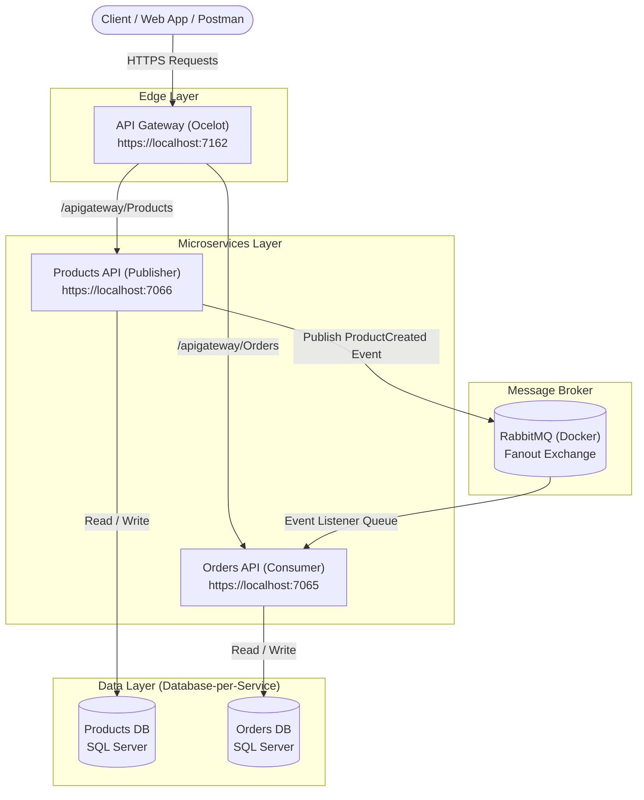

# ASP.NET Core Microservices Architecture with Ocelot & RabbitMQ

[](https://dotnet.microsoft.com/)
[](https://www.rabbitmq.com/)
[](https://masstransit.io/)
[](https://github.com/ThreeMammals/Ocelot)
[](https://learn.microsoft.com/ef/core/)

A distributed, event-driven microservices architecture built with **ASP.NET Core 8**, showcasing the **API Gateway pattern (Ocelot)**, **asynchronous event messaging (RabbitMQ with MassTransit)**, and the **Database-per-Service** pattern with Entity Framework Core.

---

## 🏛️ System Architecture



---

## ✨ Key Architectural Highlights

- **API Gateway Pattern (Ocelot) :** Provides a single, secure entry point for client applications. Shields internal microservice topologies, port configurations, and protocols.
- **Event-Driven Asynchronous Messaging :** Loose coupling between `ProductsAPI` and `OrdersAPI` using **RabbitMQ** via **MassTransit**. Services communicate through published domain events rather than direct HTTP dependencies.
- **Eventual Consistency / Data Replication :** When a new product is created in `ProductsAPI`, a `ProductCreated` event is dispatched. The `OrdersAPI` consumer handles this message to update its internal local catalog, maintaining domain independence and resilience.
- **Database-per-Service Pattern :** Each microservice owns and encapsulates its own SQL Server database and migrations.

---

## 📦 Projects Overview

| Project | Port | Description |
| :--- | :--- | :--- |
| **`ApiGateway`** | `7162` | Ocelot reverse proxy routing upstream `/apigateway/*` routes to downstream microservices. |
| **`ProductsAPI`** | `7066` | Product catalog microservice and event publisher (`IPublishEndpoint`). |
| **`OrdersAPI`** | `7065` | Order management microservice and event consumer (`ProductCreatedConsumer`). |
| **`Shared`** | ClassLib | Shared contracts and message models (`ProductCreated` DTO). |

---

## 🚀 Getting Started

### Prerequisites
- [.NET 8 SDK](https://dotnet.microsoft.com/download/dotnet/8.0)
- [Docker Desktop](https://www.docker.com/products/docker-desktop/)
- SQL Server (LocalDB or SQL Server Express)

### 1. Start RabbitMQ Container
Run RabbitMQ with the Management Console using Docker:

```powershell
docker run -d --hostname my-rabbit --name ecomm -p 15672:15672 -p 4001:5672 rabbitmq:3-management
```
- **RabbitMQ Management Dashboard :** [http://localhost:15672](http://localhost:15672) (User: `guest` / Pass: `guest`)
- **AMQP Broker Port :** `localhost:4001`

### 2. Run the Services

#### Option A: Visual Studio
1. Open `MicroservicesApp.sln`.
2. Right-click on the Solution > **Configure Startup Projects...**
3. Select **Multiple Startup Projects** and set `ProductsAPI`, `OrdersAPI`, and `ApiGateway` to **Start**.
4. Press **F5**.

#### Option B: .NET CLI
Run each project in a separate terminal:
```powershell
# Terminal 1 - Products API
dotnet run --project ProductsAPI

# Terminal 2 - Orders API
dotnet run --project OrdersAPI

# Terminal 3 - API Gateway
dotnet run --project ApiGateway
```

---

## 🧪 Testing the API Flow

All client requests should be routed through the **API Gateway** (`https://localhost:7162`).

### 1. Create a Product (Triggers Event Publishing)
```http
POST https://localhost:7162/apigateway/Products
Content-Type: application/json

{
  "name": "Mechanical Keyboard RGB",
  "stockQte": 150,
  "price": 89.99
}
```
**What happens :**
1. `ProductsAPI` persists the product in its database and returns `201 Created`.
2. `ProductsAPI` publishes a `ProductCreated` event to RabbitMQ.
3. `OrdersAPI` receives the message through its `event-listener` consumer queue.
4. `OrdersAPI` creates a replicated entry in its internal products table automatically.

### 2. Fetch Products via Gateway
```http
GET https://localhost:7162/apigateway/Products
GET https://localhost:7162/apigateway/Products/1
```

### 3. Create and Fetch Orders via Gateway
```http
POST https://localhost:7162/apigateway/Orders
Content-Type: application/json

{
  "orderDate": "2026-11-25T10:00:00Z",
  "customerName": "Alice Dupont",
  "productId": 1
}
```
```http
GET https://localhost:7162/apigateway/Orders
```

---

## 📄 License
This project is open-source and available under the MIT License.
